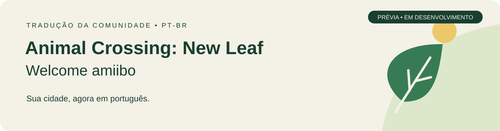

  
  
  

  <a href="https://github.com/jhonsantosx/ACNL-Welcome-Amiibo-PTBR/releases"><b>Baixar a tradução</b></a> ·
  <a href="docs/INSTALACAO.md">Como instalar</a> ·
  <a href="https://github.com/jhonsantosx/ACNL-Welcome-Amiibo-PTBR/issues/new/choose">Enviar feedback</a>

[Português brasileiro](README.md) · **[English](README.en.md)**

# Animal Crossing: New Leaf — Tradução PT-BR 🌿

**A vida em Welcome amiibo, com cada conversa mais perto de você.**

Este projeto tem como objetivo traduzir **Animal Crossing: New Leaf — Welcome amiibo** para português brasileiro: das primeiras conversas na estação às cartas dos moradores, passando pelos menus, itens, lojas e eventos que fazem parte da rotina da cidade. A proposta é permitir que jogadores brasileiros acompanhem as histórias, entendam as atividades e aproveitem os pequenos detalhes do jogo no próprio idioma.

O trabalho vai além da troca de palavras. Envolve adaptar piadas e expressões, preservar a personalidade de cada morador, manter os termos consistentes e ajustar as falas ao espaço disponível na tela. A revisão também considera as variações de diálogo e os comandos que controlam nomes, respostas e pausas, para que o texto faça sentido dentro de cada cena.

A tradução é distribuída como um **patch separado do jogo**, com instalação pelo Luma3DS e instruções para testes no Citra. As versões são publicadas com histórico de alterações e pendências conhecidas, permitindo acompanhar a evolução do projeto e atualizar o patch sem recomeçar a cidade.

> **Prévia em desenvolvimento.** Há conteúdo herdado ainda em revisão, variantes de fala pendentes e ajustes de tamanho. A contagem de textos preparados não equivale a uma tradução inteiramente revisada ou testada no console. Veja o [estado detalhado](docs/STATUS.md).

## Comece por aqui

| Quero… | Onde encontro |
| :--- | :--- |
| Jogar no 3DS com Luma | [Instalação no console](docs/INSTALACAO.md#no-nintendo-3ds-com-luma3ds) |
| Testar no Citra | [Instalação no emulador](docs/INSTALACAO.md#no-citra) |
| Atualizar sem perder minha cidade | [Atualizar a tradução](docs/ATUALIZACAO.md) |
| Avisar sobre um problema | [Abrir um relato com print](https://github.com/jhonsantosx/ACNL-Welcome-Amiibo-PTBR/issues/new/choose) |
| Sugerir uma tradução ou colaborar | [Guia de contribuição](CONTRIBUTING.md) |
| Ver o que mudou | [Histórico de versões](CHANGELOG.md) |

## Edição compatível

| Campo | Valor |
| :--- | :--- |
| Jogo | New Leaf **Welcome amiibo** |
| Base | Edição norte-americana |
| Title ID | `0004000000198E00` |
| Idioma-base substituído | Inglês |
| Console | 3DS com Luma3DS e **Enable game patching** |

O New Leaf original com Title ID `0004000000086300` é outra edição. Não instale este pacote no caminho dessa versão. Combinações com outras edições ou atualizações oficiais ainda precisam de confirmação.

## Download fácil

Abra **[Releases](https://github.com/jhonsantosx/ACNL-Welcome-Amiibo-PTBR/releases)** e baixe o arquivo `ACNL_Welcome_amiibo_PTBR_…_Luma.zip` anexado à versão desejada.

- Extraia o ZIP e copie a pasta **luma** para a raiz do SD.
- Ative **Enable game patching** nas configurações do Luma.
- Para atualizar, substitua os arquivos da tradução com o jogo fechado. **Não é necessário reinstalar o jogo nem apagar seu save.**

Os botões automáticos **Source code (zip/tar.gz)** do GitHub contêm a documentação do repositório, não o pacote instalável. O [guia completo](docs/INSTALACAO.md) explica a estrutura correta.

Este projeto distribui o patch de tradução. Não disponibiliza CIA, ROM, chaves, firmware ou saves. Você precisa ter o jogo instalado separadamente.

## Erros e sugestões

Use os [formulários de feedback](https://github.com/jhonsantosx/ACNL-Welcome-Amiibo-PTBR/issues/new/choose) para relatar problemas ou sugerir alterações. Informe a versão do patch, o local da ocorrência e, se possível, inclua um print. Orientações para contribuições estão no [guia](CONTRIBUTING.md).

## Créditos

Projeto por **jhonsantosx**. Base de tradução: **[LimaJonas](https://github.com/LimaJonas/Animal-Crossing-New-Leaf-PT_BR)**. [Créditos completos](CREDITOS.md) · [Direitos](DIREITOS.md).
